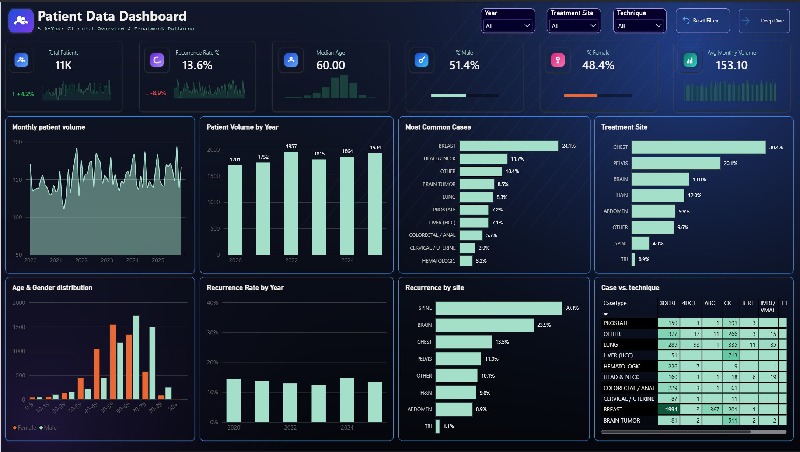
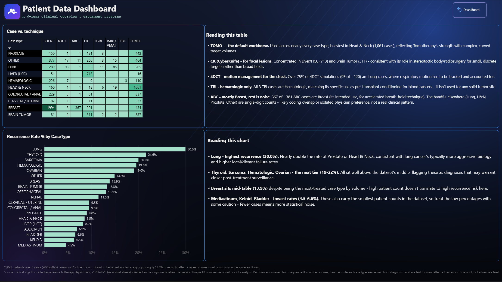

# Radiotherapy Patient Dashboard

A 6-year Power BI dashboard analyzing 11,023 anonymized Patients records from a tertiary-care radiotherapy department (2020-2025); patient volume trends, case mix, treatment technique patterns, and recurrence analysis.

## Overview

11,023 patients simulated over 6 years, averaging 153 per month. Breast is the largest single case group; roughly 13.6% of records reflect a repeat course, most commonly in the spine and brain.

## Pages

**Patient Dashboard** - KPI overview (total patients, recurrence rate, median age, gender split, monthly volume) with trend sparklines, plus monthly/yearly volume, case mix, treatment site, age & gender distribution, and recurrence trends.

**Clinical Deep-Dive** - A case-type × treatment-technique matrix with annotated clinical interpretation, and a recurrence-rate-by-case-type ranking with its own narrative breakdown (e.g. CyberKnife concentrated in focal lesions, 4DCT driven by lung motion management, TBI isolated to hematologic conditioning).

## Key insights

- **Lung has the highest recurrence rate (30.0%)** - nearly double Prostate or Head & Neck, consistent with more aggressive disease biology.
- **TOMO is the default workhorse technique**, used across nearly every case type, heaviest in Head & Neck.
- **CyberKnife (CK) concentrates in Liver/HCC and Brain Tumor** - its role as a focal SBRT/SRS technique, not a broad-field one.
- **TBI is used exclusively for Hematologic cases** - matching its specific role as pre-transplant conditioning.

## Tech stack

Power BI Desktop · DAX measures · Power Query (M) · custom report theme

## Data source & methodology

CT-simulation logs from a tertiary-care radiotherapy department, 2020–2025 (six annual sheets), cleaned and anonymized — patient names and MRD/RT numbers removed prior to analysis. Recurrence is inferred from sequential RT-number suffixes; treatment site and case type are derived from diagnosis and site text. Figures reflect a fixed export snapshot, not a live data feed.

## Author

**Vineeth Muraleedharan** — Senior Radiation Therapist (RTT) · [GitHub](https://github.com/Vineeth-Muraleedharan)
